<!-- _class: lead invert -->
<!-- _paginate: false -->

# セル・オートマトンの世界

**Nunu_3060**
本職はテストエンジニア。
趣味で Python などを使って色々作っている。

---

## 目次

1. セル・オートマトンとは
2. 1 次元の世界
3. 生命：ライフゲーム
4. 交通渋滞
5. 風紋
6. まとめ

---

## これらは数行の規則から生まれた

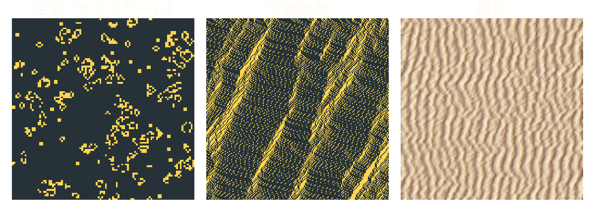

**3 つとも、数行の規則を繰り返しただけの結果である**

---

## セル・オートマトンの仕組み

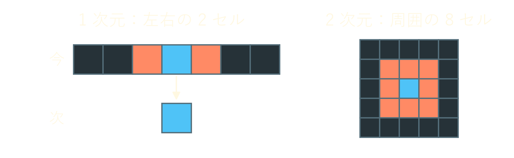

* マス目（セル）が並び、各セルは 0・1 などの状態を持つ
* 次の状態は、自分と近傍のセルの今の状態だけで決まる
* **全セルを同時に**更新し、これを繰り返す

---

## 規則は 256 通り

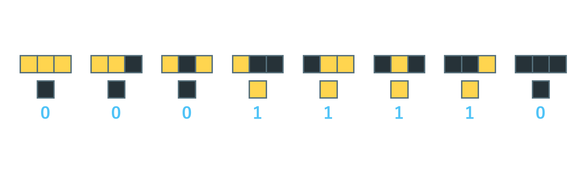

* 上段が自分と左右の 3 セル、下段が自分の次の状態
* 3 セルの組は 8 通りなので、規則は 28 = 256 通りある
* 下段の 0・1 を並べた 2 進数 00011110 = 30 を**ルール番号**と呼ぶ

---

## 4 つの性格

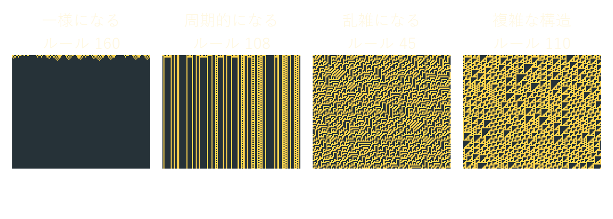

* 横が 1 列のセル、下へ時間が進む（時空図）
* 同じ初期配置でも、規則によって 4 種類の振る舞いに分かれる

ウルフラムによる分類（1984 年）

---

## 単純な規則から乱数が出る

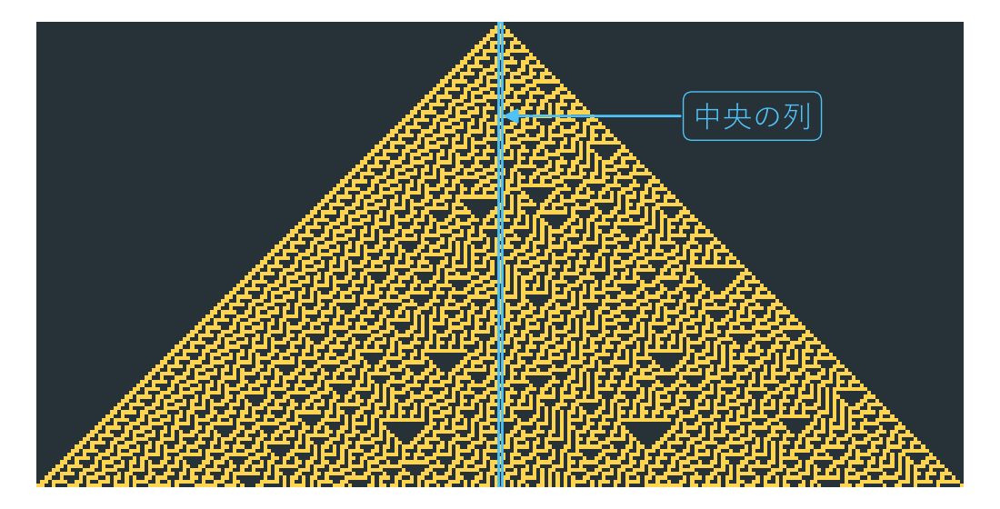

* 中央の 1 セルから始めても、ルール 30 の時空図は不規則になる
* 中央の列は乱数として使われた（Mathematica 6.0 より前の整数の乱数生成）

---

## 規則は 2 行

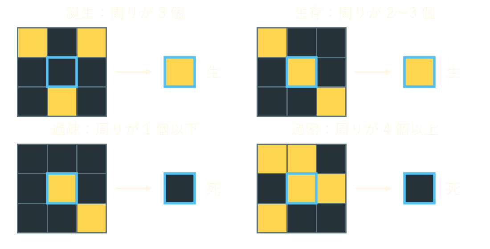

* 周りの生きたセルが **3 個なら誕生**する
* **2〜3 個なら生存**し、それ以外は死ぬ

コンウェイが 1970 年に考案した

---

## 動く・増える

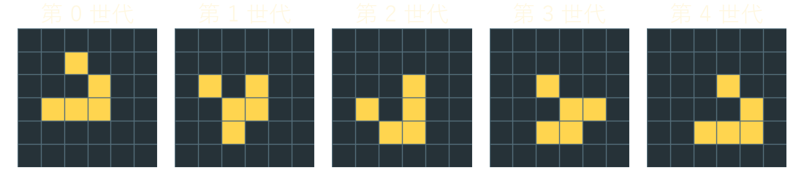
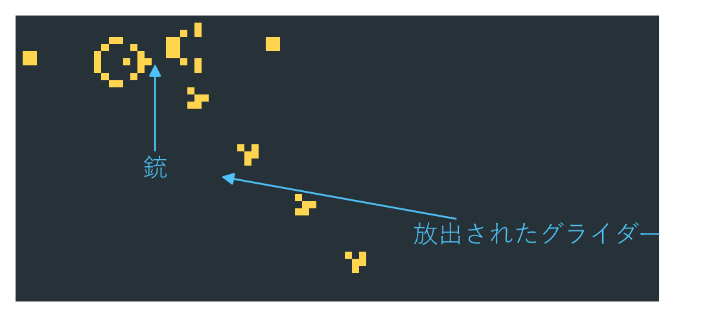

* **グライダー**：4 世代で斜めに 1 セル進む
* **グライダー銃**：30 世代ごとにグライダーを放出し続ける

---

## ライフゲームはコンピューターになる


* グライダーの有無を 1・0 とみなすと、論理回路や記憶装置を組める（計算万能）
* そのため「このパターンはいつか消えるか」は、一般には計算で判定できない

---

## 前が空いていれば進む

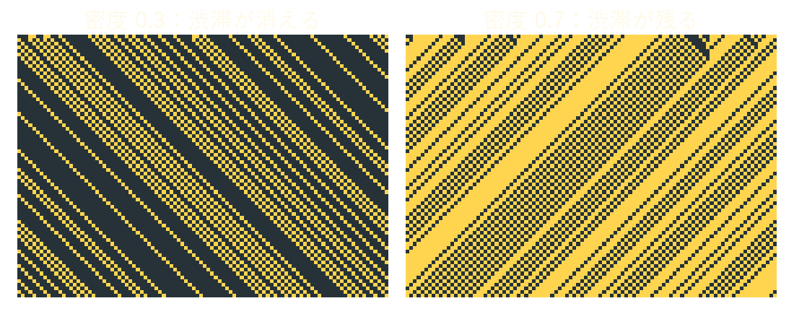

* 1 を車とみなすと、ルール 184 は「前が空いていれば進む」だけの規則になる
* 密度が 1/2 を超えると渋滞が残り、**車と逆向きに**移動する

横が道路（車は右へ進む）、下へ時間が進む

---

## 原因の無い渋滞

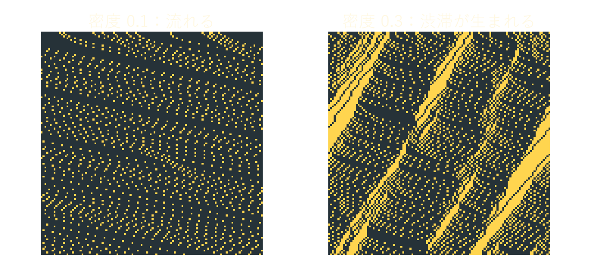

* 加速・前の車に合わせた減速・**ランダムな減速**・移動の 4 規則
* 事故も合流も無いのに渋滞が生まれ、後ろへ伝わる
* 周回路を走る実車の実験（2008 年）でも、同じ現象が確認された

---

## 交差点では全体が止まる

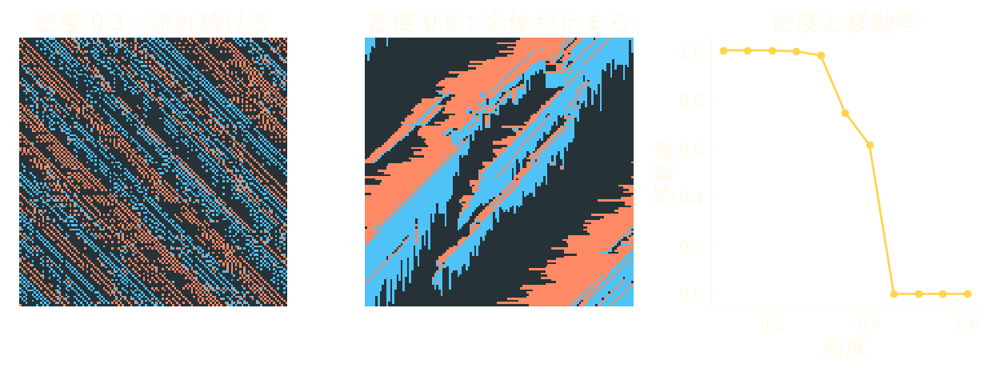

* 北向き（青）と東向き（橙）の車が、交互に「前が空いていれば進む」
* 自分で実装した結果、密度 0.3 を超えると動きが鈍り、0.45 で完全に止まった

BML 交通モデル（1992 年）。128 × 128 の盤面で 1000 ステップ後

---

## 砂を飛ばして均すだけ

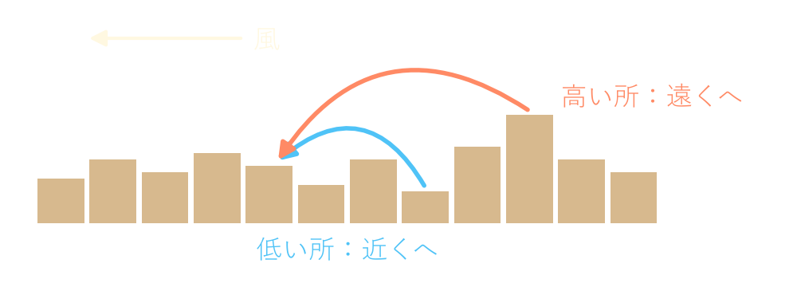

1. 各セルは砂を風下へ飛ばし、**高い所ほど遠くへ**飛ぶ
2. 周りのセルと高さを少し均す

Nishimori・Ouchi のモデル（1993 年）。状態が連続値（砂の高さ）なので、セル・オートマトンの考え方を連続値に広げたものである

---

## 風紋が現れる

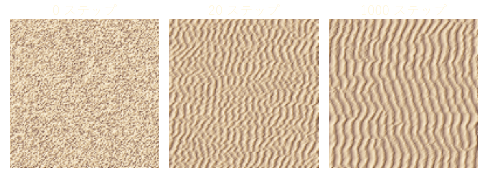

* 乱雑な初期状態から、20 ステップで縞模様が現れる
* 砂の総量は変わらず、縞の間隔は時間とともに少しずつ広がる

---

## 実行しないと分からない

* ライフゲームの規則は 2 行だが、行く末は一般に予測できない
* BML 交通モデルは、密度を少し変えただけで全体の振る舞いが変わる
* **単純な仕様でも、振る舞いは動かして初めて分かる**

テストエンジニアとして、ここにテストで確かめる理由があると考える。

---

## まとめ

* セル・オートマトンは、局所的な規則を全セルで同時に繰り返す
* 数行の規則から、生命のような振る舞い・渋滞・風紋が生まれる
* その振る舞いは、実行してみないと分からない
* numpy があれば、どれも数十行の Python で試せる

---

<!-- _class: refs invert -->

## 参考文献

* Nunu_3060, 「セル・オートマトンの理論と歴史」, <https://nunu-3060.github.io/sphinx_docs_mathematics/cellular_automata_theory_and_history/index.html>
* Nunu_3060, 「Python によるライフゲームの実装」, <https://nunu-3060.github.io/sphinx_docs_mathematics/python_simulation_lifegame/index.html>
* Nunu_3060, 「Python による BML 交通モデルの実装」, <https://nunu-3060.github.io/sphinx_docs_mathematics/python_simulation_bml_traffic_model/index.html>
* Nunu_3060, 「Python による飛砂のシミュレーションの実装」, <https://nunu-3060.github.io/sphinx_docs_mathematics/python_simulation_sand/index.html>
* S. Wolfram, "Statistical mechanics of cellular automata", Rev. Mod. Phys. 55, 601 (1983). <https://doi.org/10.1103/RevModPhys.55.601>
* S. Wolfram, "Universality and complexity in cellular automata", Physica D 10, 1 (1984). <https://doi.org/10.1016/0167-2789(84)90245-8>
* E. W. Weisstein, "Rule 30", MathWorld. <https://mathworld.wolfram.com/Rule30.html>
* M. Gardner, "Mathematical Games", Scientific American 223, 120 (1970). <https://doi.org/10.1038/scientificamerican1070-120>
* E. R. Berlekamp, J. H. Conway, R. K. Guy, *Winning Ways for Your Mathematical Plays*, Vol. 2, Academic Press (1982).
* K. Nagel, M. Schreckenberg, "A cellular automaton model for freeway traffic", J. Phys. I France 2, 2221 (1992). <https://doi.org/10.1051/jp1:1992277>
* Y. Sugiyama et al., "Traffic jams without bottlenecks", New J. Phys. 10, 033001 (2008). <https://doi.org/10.1088/1367-2630/10/3/033001>
* O. Biham, A. A. Middleton, D. Levine, "Self-organization and a dynamical transition in traffic-flow models", Phys. Rev. A 46, R6124 (1992). <https://doi.org/10.1103/PhysRevA.46.R6124>
* H. Nishimori, N. Ouchi, "Formation of ripple patterns and dunes by wind-blown sand", Phys. Rev. Lett. 71, 197 (1993). <https://doi.org/10.1103/PhysRevLett.71.197>
