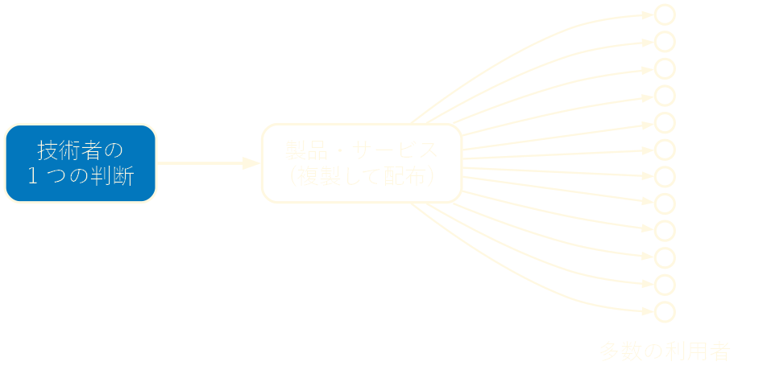
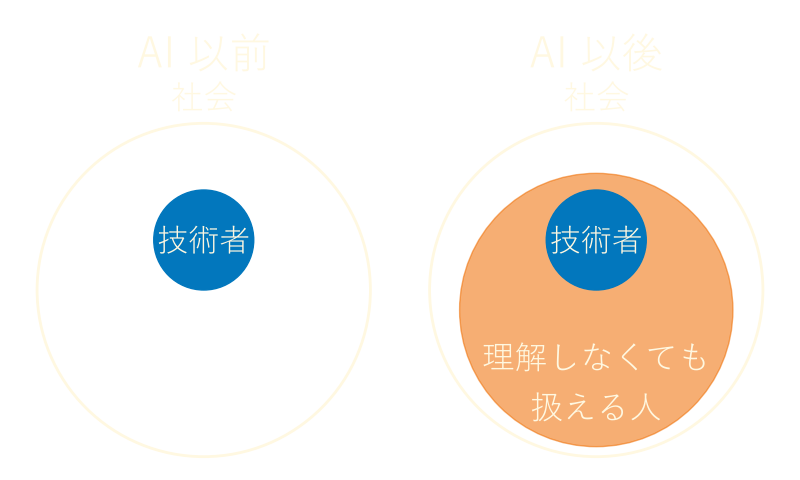

<!-- _class: lead invert -->
<!-- _paginate: false -->

# AI 時代の技術者倫理

**Nunu_3060**
本職はテストエンジニア。

---

## 目次

1. はじめに
2. なぜ技術者に倫理が要るのか
3. AI 時代に何が変わったか
4. 何をすべきか
5. まとめ

---

## 「できる」と「やってよい」は別物

**技術的に可能なことと、やってよいことは一致しない**

* 調査のために、本番の個人データを手元にコピーする
* テストで見つけた不具合を「軽微」として報告しない
* 仕組みを理解しないまま、動いたコードを出荷する

どれも技術的には簡単にできる。やってよいかどうかは、技術では決まらない。

---

## 技術者倫理とは

**専門知識を持つ者が、社会に対して負う責任**

* 技術者の団体は倫理綱領を定めている
* 多くの綱領が、公衆の安全を最優先に掲げている

> 技術士は、公衆の安全、健康及び福利を最優先する。
> （日本技術士会「技術士倫理綱領」）

* 法律に違反するかどうかより手前で、自分を律するための拠り所

---

## 技術は影響を増幅する

**1 人の判断が、製品を通じて多数の人に届く**
ソフトウェアは複製の費用がほぼ無いため、同じ欠陥が全利用者に届く。

---

## 事例 1：Therac-25

**安全をソフトウェアだけに任せ、過剰照射を招いた**

* 1985 〜 1987 年、放射線治療装置で 6 件の過剰照射事故が起き、死者も出た
* 前の機種にあったハードウェアの安全装置を省き、ソフトウェアの検査だけに頼った
* 原因の 1 つは競合状態。操作者が素早く入力を修正すると、設定が食い違ったまま照射された
* 事故の報告を受けても、メーカーは当初、過剰照射は起こり得ないと主張した

---

## 事例 2：英国郵便局 Horizon 事件

**「システムは正しい」という前提が、無実の人を罪に問うた**

* 郵便局の会計システム Horizon が、実在しない不足金を表示した
* 郵便局は 1999 〜 2015 年に 700 人以上を訴追した。多くは郵便局の運営を委託された局長だった
* 2019 年、高等法院は Horizon に不具合があったと認定した
* 不具合を把握していた関係者がいたにもかかわらず、システムの正しさが主張され続けた

---

## 事例 3：VW 排出ガス不正

**組織の指示に従った技術者も、責任を問われた**

* 試験中だけ排出ガスを抑える不正なソフトウェアを、ディーゼル車に搭載した
* 2015 年に米国環境保護庁（EPA） が違反を通知した
* 不正なソフトウェアの開発に関わった技術者は、2017 年に禁錮 40 か月の判決を受けた
* 「上の指示だった」は、責任を免れる理由にならなかった

---

## 事例の共通点

**原因は悪意よりも、過信・沈黙・組織の圧力**

| 事例 | 過信 | 沈黙・組織の圧力 |
| --- | --- | --- |
| Therac-25 | ソフトウェアを過信した | 事故の報告を軽視した |
| Horizon 事件 | システムの出力を過信した | 不具合を知りながら伏せた |
| VW 排出ガス不正 | - | 不正と知りながら指示に従った |

どれも特別な悪人の話ではない。どの技術者にも起こり得る。

---

## 誰でも作れる時代

**AI により、技術を扱える人の範囲が広がった**
非技術者もコード・画像・音声を作れる。技術者も、専門外の領域を扱える。

---

## リスク 1：理解しないまま世に出す

**動くことと、安全であることは別物**

* 脆弱性が生じやすい場面で GitHub Copilot が生成したコードを調べると、約 40 % に脆弱性があった（2022 年の研究）
* AI は存在しないパッケージ名を提案することがある。攻撃者がその名前で悪意あるパッケージを公開すれば、そのまま取り込まれる
* 生成物のライセンスや、AI に入力した機密情報の扱いも、使う人の責任

---

## リスク 2：悪用の敷居が下がる

**専門技術がなくても、人をだます道具が作れる**

* 実在の人物の顔や声を模した動画・音声（ディープフェイク）
* 自然な文面のフィッシングメールの大量作成
* 不正なプログラムの作成

かつては技術の難しさが悪用を抑えていた。その壁はもう低い。

---

## 変わらないもの

**責任は道具ではなく、使う人にある**

* AI は、自分の出力が招いた結果に責任を負わない
* 「AI が書いた」は、「ソフトウェアが判断した」と同じく言い訳にならない
* 世に出したものの責任は、出すと決めた人が負う

道具が変わっても、責任の所在は変わらない。だから技術者倫理はどの時代にも要る。

---

## 現場でできること

**出す前に、立ち止まる**

* **説明できないものは出さない**：AI の生成物も、自分のコードとして読む
* **検証する**：動作だけでなく、安全・権利・個人情報まで確かめる
* **懸念は声に出す**：沈黙は加担になり得る
* **迷ったら倫理綱領に戻る**：判断の拠り所にする

---

## テストは倫理の実践

**リスクを見つけ、見える形にし、伝える**

* テストは、期待どおりに動くかに加えて、人に害を与えないかを確かめる仕事
* 見つけたリスクは、相手が判断できる形で伝える
* Horizon 事件は、システムの出力を疑って検証する姿勢が欠けた例
* AI の生成物にも、同じ姿勢で向き合う

---

## 技術を知る者の役割

**周りの人を守るのも、技術者の仕事**

* AI で何かを作る非技術者は、危険に気づきにくい
* 気づける立場の人が、何が危ないか、なぜ危ないかを伝える
* 個人の注意だけに頼らず、レビュー・権限の制限・自動検査などの仕組みで防ぐ
* 技術者倫理を、個人の心得から組織の文化に広げる

---

## まとめ

* 技術は 1 人の判断を多数の人に届ける。だから技術者には倫理が要る
* 問題の原因は悪意よりも、過信・沈黙・組織の圧力
* AI で技術を扱える人が広がっても、責任は使う人にある
* 説明できないものは出さない。検証する。声を上げる。周りに伝える

**道具が変わっても、技術を扱う者の責任は変わらない**

---

<!-- _class: refs invert -->

## 参考文献

* 公益社団法人日本技術士会, 技術士倫理綱領, <https://www.engineer.or.jp/c_topics/009/009289.html>
* 一般社団法人情報処理学会, 倫理綱領, <https://www.ipsj.or.jp/ipsjcode.html>
* Leveson, N. G., & Turner, C. S. (1993). An Investigation of the Therac-25 Accidents. *IEEE Computer*, 26(7), 18–41. <https://doi.org/10.1109/MC.1993.274940>
* Post Office Horizon IT Inquiry, <https://www.postofficehorizoninquiry.org.uk/>
* U.S. Department of Justice (2017). Volkswagen Engineer Sentenced for His Role in Conspiracy to Cheat U.S. Emissions Tests. <https://www.justice.gov/archives/opa/pr/volkswagen-engineer-sentenced-his-role-conspiracy-cheat-us-emissions-tests>
* U.S. EPA, Volkswagen Light Duty Diesel Vehicle Violations for Model Years 2009-2016, <https://www.epa.gov/vw>
* Pearce, H. et al. (2022). Asleep at the Keyboard? Assessing the Security of GitHub Copilot's Code Contributions. *IEEE S&P*. <https://arxiv.org/abs/2108.09293>
* Spracklen, J. et al. (2025). We Have a Package for You! A Comprehensive Analysis of Package Hallucinations by Code Generating LLMs. *USENIX Security*. <https://arxiv.org/abs/2406.10279>
