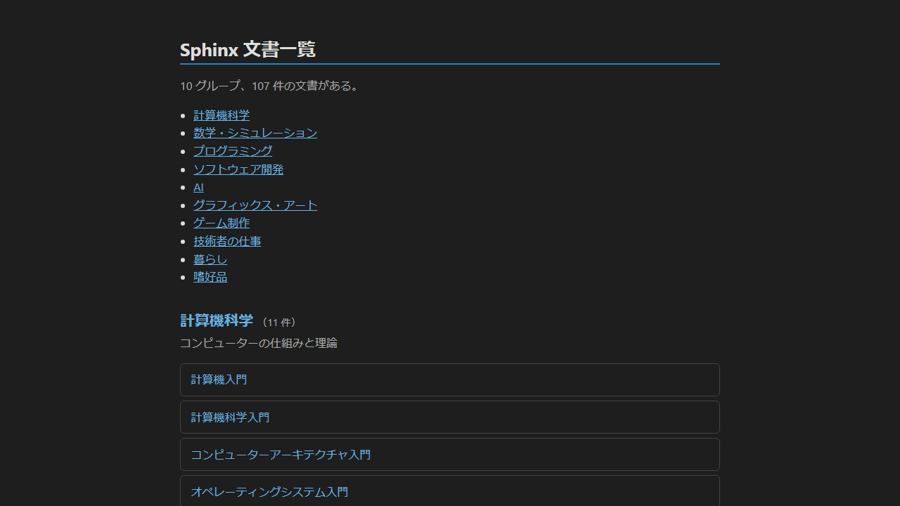
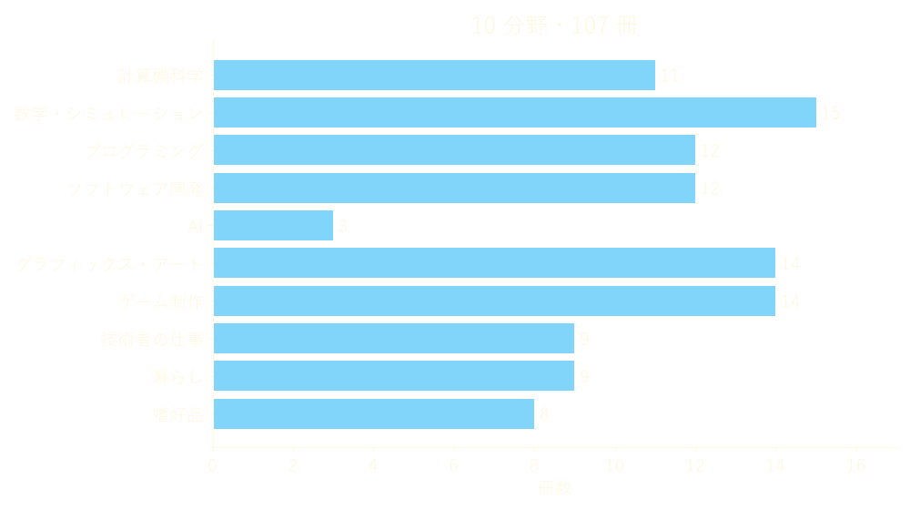
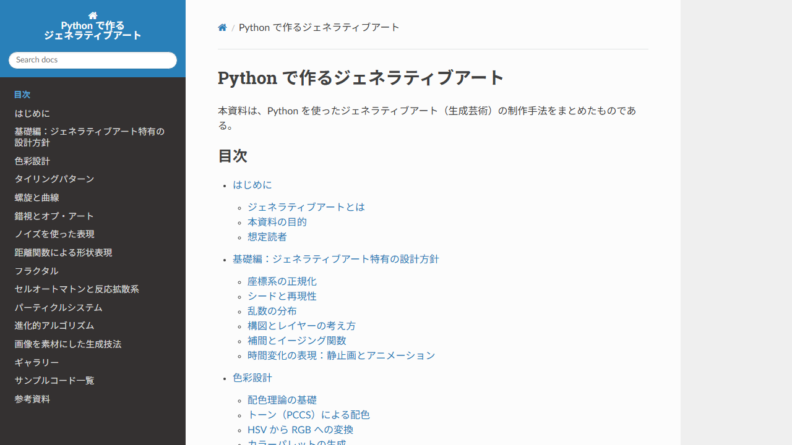

<!-- _class: lead invert -->
<!-- _paginate: false -->

# 学びに AI を如何に生かすか？



**Nunu_3060**
本職はテストエンジニア。AI に書かせた入門書で、仕事や趣味の分野を学んでいる。

---

## 目次

1. はじめに
2. なぜ文書にするのか
3. 書かせ方
4. 1 冊の例
5. 読み方
6. まとめ

---

## Claude Code に入門書を書かせて学ぶ

**学びたい分野ごとに、入門書を 1 冊書かせて読む**

* 使う AI は Claude Code
* チャットで答えるだけでなく、ファイルを作り、コマンドを実行できる
* 本文・サンプルコード・図の生成からビルド・検査までを任せられる
* 形式は Sphinx の技術文書（HTML で読める）

---

## 107 冊の入門書



計算機科学から嗜好品まで、GitHub Pages で公開している。

---

## 質問だけでは足りない

**チャットの回答は、学習の材料としては断片的**

* 聞いたことにしか答えが返ってこない
* 何を知らないのかが分からないので、質問できない
* 回答はやり取りの中に流れて、後から探しにくい
* 分野の全体像が見えない

---

## 文書にする利点

**入門書は、分野の地図になる**

* 章立てを見れば、何を学ぶべきかが分かる
* 自分が知らなかった事柄も、章として現れる
* いつでも読み返せる
* ビルドやコードの検査で、品質を機械的に確かめられる

---

## 全体の流れ


* 塗りつぶしは自分の作業、枠線のみは Claude Code の作業
* 依頼と報告は prompt.md と result.md というファイルでやり取りする
* 読んで疑問が出たら、追加で書かせる

---

## 依頼は雛形 1 枚

**prompt_template.md の空欄を埋めて依頼する**

```markdown
## 題目
「題目」
## 作業内容
「作業内容」
## 目的
「目的」
## 対象読者
Python 等の知識はあるエンジニア
## 注意事項
（フォルダ構成・コードの検査・文章の体裁など、毎回同じ条件）
## 報告
本プロンプトに不明瞭な部分や不適切な部分などがある場合は指摘し報告する。
```

---

## まず構成を提案させる

**いきなり書かせず、目次案を先に出させる**

* 目次案を読むだけで、分野の全体像が分かる
* 足りない章・不要な章をこの段階で直せる
* 107 冊中 81 冊が、この 2 段階で書かれた

```markdown
result.md を確認した。

1. 追加する。
2. データ構造としての八分木は紹介にとどめる。
3. 10, 15 章にサンプルを追加する。
```

---

## 品質の条件を機械的に課す

**AI の自己申告より、検査の結果を信じる**

* サンプルコード: PEP 8・型ヒント・flake8・mypy（strict）
* 文章: 常体に統一、表記ゆれ、和文中の英数字の前後の空白
* 文書: ビルドが通るか、リンク切れが無いか
* 条件は雛形に書いておき、毎回同じものを課す

---

## 不明瞭な点を報告させる

**依頼の曖昧さを指摘させると、自分の理解の穴が分かる**

* 雛形の最後に「不明瞭・不適切な点を指摘する」と必ず書く
* 指摘の例
  * 誤記と思われる箇所を、どう解釈したか
  * 設定ファイルの文字コードで、検査が止まる環境がある
  * 既存の仕組みで、図が再生成されない場合がある
* 自分が考えていなかった観点を知る機会になる

---

## 1 冊の規模



**Python で作るジェネラティブアート**
本文 13 章・サンプルコード 49 本・図 100 枚超

---

## 読んで広がったこと

 

* 色彩設計やセル・オートマトンなどのシミュレーションの手法を学んだ
* 趣味のクリエイティブコーディングで作れるものの幅が広がった

---

## 任せきりでは身に付かない

**答えを AI に任せると、作業は進んでも学習は起きない**

* 高校の数学: 制限の無い AI で練習した群は、AI 無しの試験で AI を使わなかった群より成績が低かった
* ライブラリの習得: AI の支援を受けた群は、概念の理解やデバッグの力が低かった
* AI の書いた文書も誤りを含みうる

<p class="note">いずれも、AI に書かせた入門書「独学の方法と学習科学」で知った研究である。</p>

---

## 書かせた後の読み方

**テストと同じく、疑って確かめる**

1. まずは文書を一通り読む
2. 矛盾や誤りが無いか確認する
3. できればサンプルを試し、意図通りに動くか確認する
4. 学んだことを業務などに生かせないか考え、生かすよう努める

例: NumPy・pandas による高速で効率的な計算や、Matplotlib による可視化が業務に役立った。

---

## 始めてみる

**雛形 1 枚と題目 1 つから始められる**

* 最初は小さな分野、興味のある分野でよい
* 対象読者を自分に合わせて書く
* 構成の提案を読むだけでも、分野の見取り図が手に入る
* 品質の条件と、不明瞭な点の報告は最初から入れておく

---

## まとめ

**体系は Claude Code に書かせ、理解は自分で確かめる**

* 質問ではなく、入門書を 1 冊書かせると、分野の全体像がつかめる
* 雛形・構成の提案・機械的な検査で、文書の品質を保つ
* 読むだけでは身に付かない。疑って確かめ、手を動かし、仕事や趣味に生かす

---

<!-- _class: refs invert -->

## 参考文献

* Nunu_3060, Sphinx 文書一覧, <https://nunu-3060.github.io/sphinx_docs/>
* Nunu_3060, Python で作るジェネラティブアート, <https://nunu-3060.github.io/sphinx_docs_graphics_and_art/python_generative_art/index.html>
* Anthropic, Claude Code の概要, <https://code.claude.com/docs/ja/overview>
* Bastani, H. et al. (2025). Generative AI without guardrails can harm learning: Evidence from high school mathematics. *PNAS*, 122(26), e2422633122. <https://doi.org/10.1073/pnas.2422633122>
* Shen, J. H., & Tamkin, A. (2026). How AI impacts skill formation. arXiv:2601.20245. <https://arxiv.org/abs/2601.20245>
