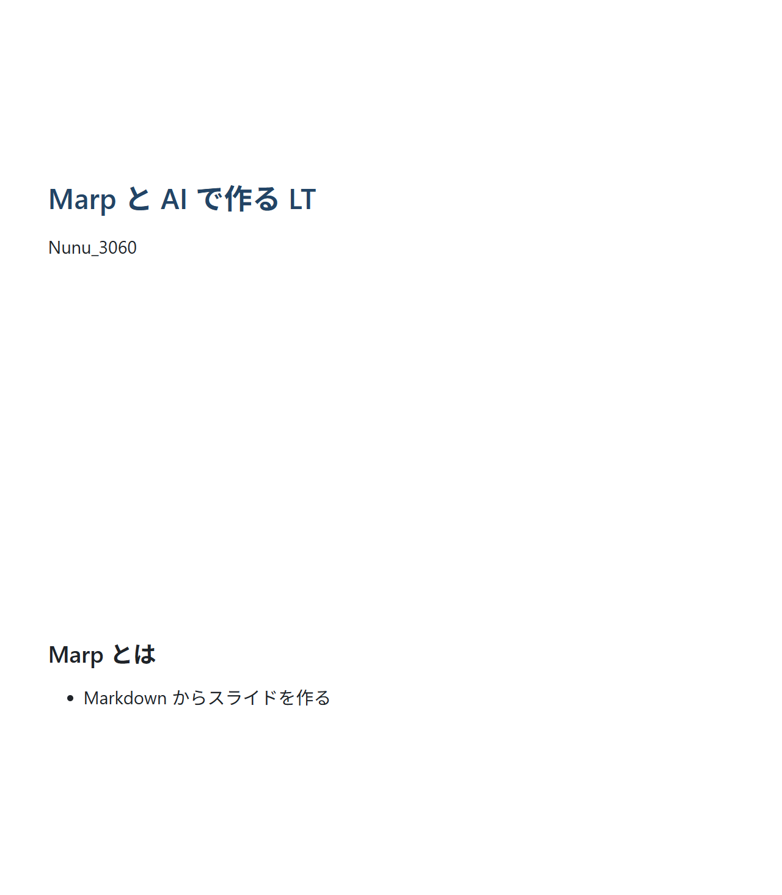
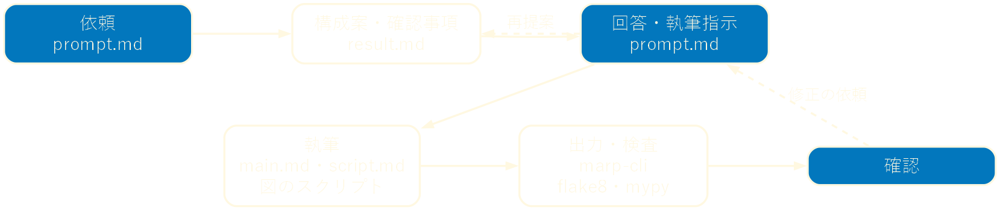
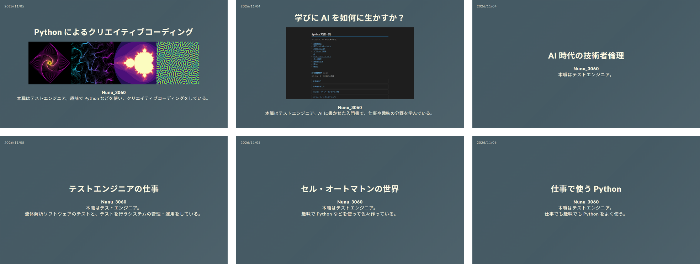

<!-- _class: lead invert -->
<!-- _paginate: false -->

# Marp と AI で作る LT

**Nunu_3060**
本職はテストエンジニア。LT の資料を Marp と Claude Code で作っている。

---

## 目次

1. はじめに
2. Marp
3. 作り方
4. やってみて
5. まとめ

---

## 資料作りに数日かかっていた

* 以前の LT「お絵描き matplotlib」も Marp で書いた
* 構成・文章・図・体裁の調整をすべて自分でやった
* 1 本に数日以上かかった

---

## Marp で書き、Claude Code に書かせ、人が決める

* Marp: Markdown でスライドを書く
* Claude Code: スライド・図・台本を書き、出力して確かめる
* 人: 何を・誰に話すかを決め、出来上がりを確かめる
* この資料もこの方法で作った

---

## Markdown がスライドになる



```markdown
---
marp: true
theme: default
---

# Marp と AI で作る LT

Nunu_3060

---

## Marp とは

* Markdown からスライドを作る
```

* `---` でページを区切る
* HTML・PDF・PPTX に出力できる
* Marp for VS Code・marp-cli で使える

---

## テキストだから Claude Code と相性が良い

* Claude Code はファイルを直接書き、コマンドを実行できる
* marp-cli で画像や PDF に出力させ、表示崩れを自分で確かめさせられる
* 変更は差分で読める
* Git で管理できる

---

## 全体の流れ



* 塗りつぶしは自分の作業、枠線のみは Claude Code の作業
* 依頼と報告は prompt.md と result.md というファイルでやり取りする

---

## 依頼は雛形 1 枚

```markdown
## 題目
## 目的
## 対象オーディエンス
## 作業内容
## 表紙の内容
## 分量            （発表 15 分程度、1 ページ 1 分程度）
## フォルダ・ファイル構成（main.md・script.md・image・script の条件）
## 報告            （不明瞭・不適切な点を指摘し、result.md に出力する）
```

* 毎回書くのは題目・目的・対象オーディエンス・作業内容だけ
* 体裁や検査の条件は雛形に書いてあり、毎回同じものを課す

---

## まず構成を提案させる

```markdown
<!-- result.md（Claude Code の確認事項） -->
1. 使う AI: 隣の「学びに AI を如何に生かすか？」では Claude Code と
   明記していた。本 LT でも Claude Code として紹介してよいか。

<!-- prompt.md（自分の回答） -->
1. AI: Claude Code と明記してよい。
```

* いきなり書かせず、構成案と確認事項を出させる
* この LT は構成案のやり取りを 3 回して、執筆に入った

---

## 体裁の条件を書いておく

```markdown
* 出力されるスライドの表示が崩れないことを優先する。
* 常体に統一する。
* 日本語の文章中に英単語や数字を入れる際は前後に半角空白を入れる。
* 1 ページ 1 メッセージにする。
```

* 細かい体裁を、最初から守らせる
* marp-cli で全ページを画像に出力させ、はみ出しを確かめさせる

---

## 図はコードで描かせる

```markdown
* script
  * image に出力する画像を出力するコードを置く場所
  * PEP8・型ヒント・flake8・mypy（strict）
  * Graphviz・Pillow・matplotlib などが使える
```

* 流れ図や表紙の一覧も、Python と Graphviz のスクリプトで作った
* スクリプトを直して実行し直せば、図を何度でも作り直せる

---

## 台本も一緒に書かせる

```markdown
## 7

* 流れの説明
  * prompt.md で依頼し、result.md で報告させる。
  * 構成が決まるまで何度でもやり取りする。
```

* script.md に、ページごとに話す内容を箇条書きで出させる
* 台本は自分で手直しして、自分の言葉で話す

---

## 数日から 1 日以内へ



* 依頼を書き始めてから確認が終わるまで 1 日以内
* 4 日間で 6 本作った（うち 2 本は没にした）

---

## 没 1：経験者向けのつもりが初心者向けに

* 「仕事で使う Python」
* 対象オーディエンスには「経験年数は皆浅くない」と書いていた
* しかし目的は「どのように使われているか紹介する」だけだった
* 用途を一通り並べる構成になり、内容が初心者向けになった
* 教訓: 聞き手が何を持ち帰るかを目的に書く

---

## 没 2：聞き手にとって当たり前だった

* 「AI 時代の技術者倫理」
* 目的には主張をはっきり書いていた
* しかし主張自体が、経験のあるエンジニアには既知だった
* Claude Code は依頼された主張を整えて書くが、面白いかは判断しない
* 教訓: 聞き手にとって新しいかで目的を選ぶ

---

## 人がやること

* 目的と聞き手を具体的に決める
* 構成案を聞き手の目で読む
* 自分の経験や実例を渡す
* 事実と URL を確かめる

<p class="note">没にした 2 本も、構成案の段階で気付けたはずだった。</p>

---

## まとめ

* Marp はテキストなので、Claude Code にスライド・図・台本を一式書かせられる
* 雛形・構成案・体裁の条件で、1 本が 1 日以内に作れる
* 何を・誰に話すかは人が決める。雛形を 1 枚書くところから始められる

---

<!-- _class: refs invert -->

## 参考文献

* Marp, <https://marp.app/>
* Marp for VS Code, <https://marketplace.visualstudio.com/items?itemName=marp-team.marp-vscode>
* marp-cli, <https://github.com/marp-team/marp-cli>
* Anthropic, Claude Code の概要, <https://code.claude.com/docs/ja/overview>
* Graphviz, <https://graphviz.org/>
