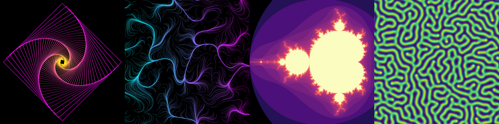
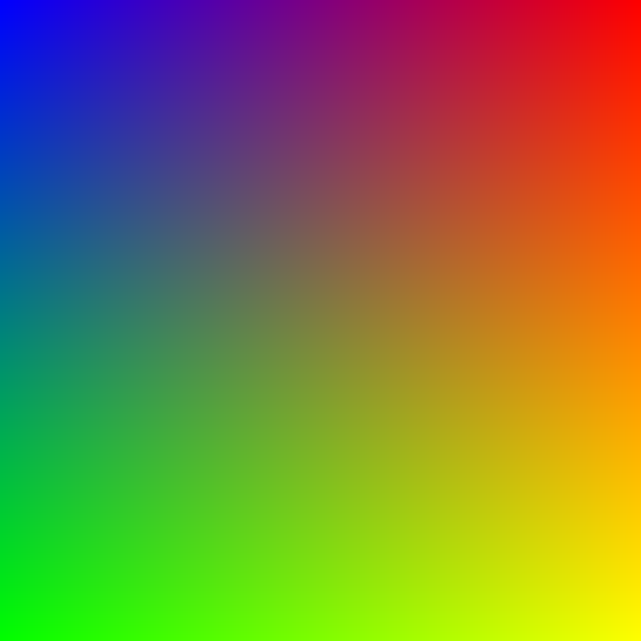
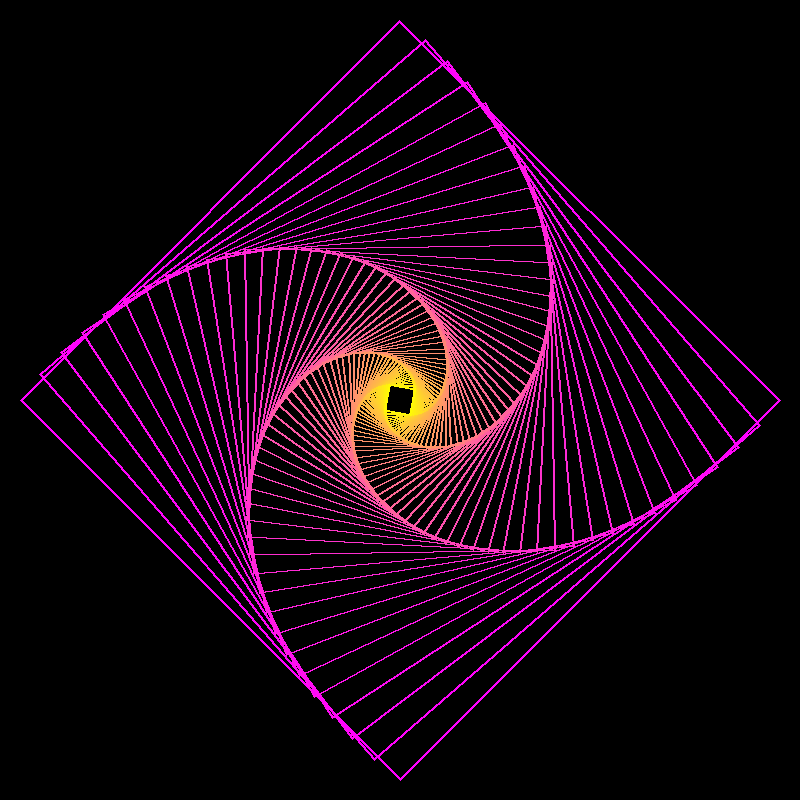
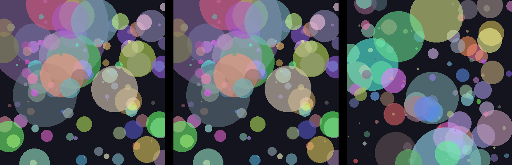
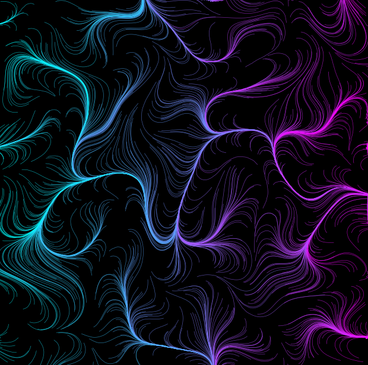
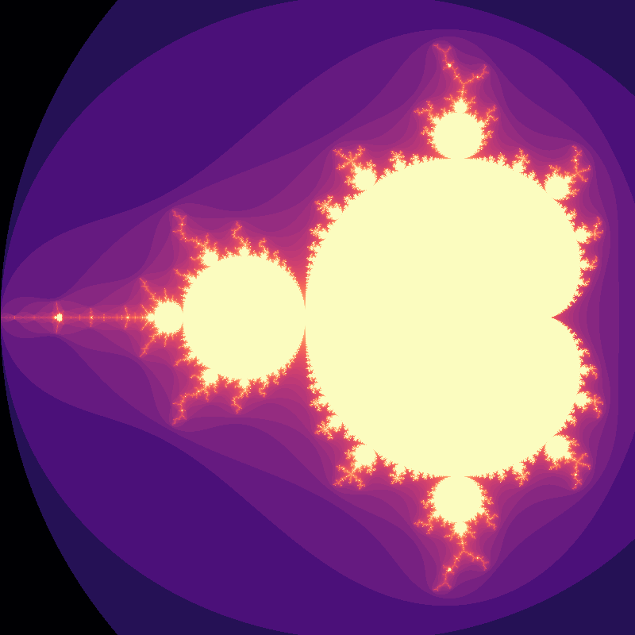
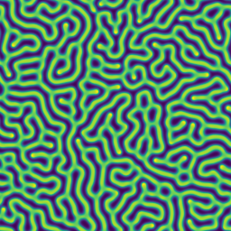
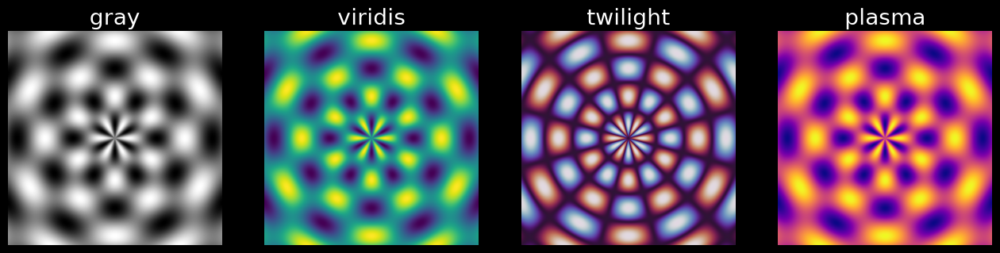
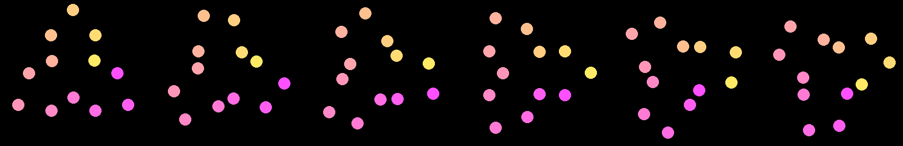

<!-- _class: lead invert -->
<!-- _paginate: false -->

# Python によるクリエイティブコーディング



**Nunu_3060**
本職はテストエンジニア。趣味で Python などを使い、クリエイティブコーディングをしている。

---

## 目次

1. はじめに
2. 道具と基本
3. 作例
4. 業務とのつながり
5. まとめ

---

## クリエイティブコーディングとは

**表現を目的としたプログラミング**

* 図形・色・動きをコードで生み出す
* 業務のプログラムと違い、結果の「面白さ」や「美しさ」を追求する
* 代表的な環境は Processing・p5.js・openFrameworks
* Python でも同じことができる

---

## なぜエンジニアがやるのか

**普段のスキルで、正解のない題材に取り組める**

* 仕様も正解もないので、自由に試行錯誤できる
* 業務の知識がそのまま活きる
* 結果が絵として目に見えるので、成果が分かりやすい
* できた作品を人に見せて楽しめる

---

## Python の道具箱

**いつものライブラリで絵が描ける**

| ライブラリ | 役割 |
| --- | --- |
| numpy | 画素や座標をまとめて計算する |
| Pillow | 図形を描き、画像を保存する |
| matplotlib | 線を描き、カラーマップで色を付ける |
| scipy | フィルタなどの数値計算をする |

どれもデータ分析や業務で使われる定番のライブラリである。

---



## 画像は数値の配列

**座標から色を計算すれば絵になる**

```python
x = np.linspace(0, 1, SIZE)
y = np.linspace(0, 1, SIZE)
xx, yy = np.meshgrid(x, y)  # 全画素の座標

img = np.zeros((SIZE, SIZE, 3), dtype=np.uint8)
img[..., 0] = xx * 255                   # 赤
img[..., 1] = yy * 255                   # 緑
img[..., 2] = (1 - xx) * (1 - yy) * 255  # 青
Image.fromarray(img).save(OUTPUT)
```

* カラー画像は「高さ × 幅 × 3 (RGB)」の配列

---



## 反復と幾何学

**単純な規則の繰り返しが模様になる**

```python
for i in range(COUNT):
    r = 380 * 0.95 ** i          # 5 % ずつ縮める
    angle = math.radians(i * 4)  # 4 度ずつ回す
    c = 255 * i // COUNT
    draw.polygon(square(SIZE / 2, SIZE / 2, r, angle),
                 outline=(255, c, 255 - c), width=2)
```

* 正方形を 60 個、回転・縮小しながら描く
* 頂点の座標は三角関数で求める

---

## 乱数とシード

**シードを固定すれば同じ絵を再現できる**

```python
rng = np.random.default_rng(seed)  # シードを固定した乱数生成器
x, y = rng.uniform(0, SIZE, 2)     # 位置
r = rng.exponential(18)            # 大きさ
```



* 左から `seed=1`・`seed=1`・`seed=2` で描いた結果

---



## ノイズとフローフィールド

**滑らかなノイズを「流れ」に変える**

```python
noise = gaussian_filter(rng.random((N, N)), sigma=12)
noise = (noise - noise.min()) / (noise.max() - noise.min())
angle = noise * 4 * np.pi  # ノイズの値を進む向きに変換
for _ in range(STEPS):
    a = angle[int(y) % N, int(x) % N]
    x, y = x + np.cos(a), y + np.sin(a)
```

* 乱数の配列をぼかして滑らかなノイズを作る
* 粒子がノイズの示す向きに進んだ軌跡を描く

---



## フラクタル

**全画素を配列演算でまとめて計算する**

```python
c = x[np.newaxis, :] + 1j * y[:, np.newaxis]
z = np.zeros_like(c)
for _ in range(MAX_ITER):
    alive = np.abs(z) <= 2  # まだ発散していない画素
    z[alive] = z[alive] ** 2 + c[alive]
    count[alive] += 1
```

* 発散するまでの反復回数で色を塗る
* 画素ごとの for 文が不要になる (ベクトル化)

---



## 反応拡散

**2 つの式から生き物のような模様が生まれる**

```python
for _ in range(STEPS):
    uvv = u * v * v  # 反応
    u += DU * laplace(u, mode="wrap") - uvv + F * (1 - u)
    v += DV * laplace(v, mode="wrap") + uvv - (F + K) * v
```

* Gray-Scott モデルで 2 種類の物質の拡散と反応を計算する
* F・K を変えると模様が斑点や縞に変わる

---

## 色の設計

**同じ形でも配色で印象が変わる**

```python
for ax, cmap in zip(axes, ["gray", "viridis", "twilight", "plasma"]):
    ax.imshow(data, cmap=cmap)
```



* matplotlib のカラーマップを差し替えるだけで描き分けられる

---

## アニメーション

**時間 t を変数にすれば動きになる**

```python
a = 2 * math.pi * (i / DOTS + t / 360)                      # 回転
r = 90 + 40 * math.sin(2 * math.pi * (t / FRAMES + i / 4))  # 半径が波打つ
```



* フレームを連番画像で出力し、ffmpeg で動画にする
  `ffmpeg -framerate 30 -i frames/%03d.png out.mp4`

---

## 業務スキルとの共通点

**作例で使った技術は業務の技術そのもの**

| 作例 | 技術 | 業務での用途 |
| --- | --- | --- |
| 画像は数値の配列・フラクタル | ベクトル化 | 大量データの高速処理 |
| 乱数とシード | 再現性の確保 | テストデータ生成・不具合の再現 |
| ノイズとフローフィールド | フィルタ処理 | 信号処理・画像処理 |
| 反応拡散 | 数値シミュレーション | 物理・工学の計算 |
| 色の設計 | 可視化 | グラフ・レポートの作成 |

---

## 業務に返ってくるもの

**遊びで得た経験が業務の引き出しになる**

* **可視化の引き出しが増える**
  伝わるグラフの配色や見せ方が身に付く
* **数値計算の勘が養われる**
  刻み幅が大きすぎると発散するといった落とし穴に気付ける
* **性能改善の練習台になる**
  画素数が多いので、for 文とベクトル化の速度差を体感できる

---

## 始め方

**小さく作って続ける**

* **まずは 1 枚作る**
  今回の作例はどれも 30 〜 50 行程度のスクリプトである
* **イベントに参加する**
  Genuary は毎年 1 月に毎日お題が出るイベントである
* **専用の環境も試す**
  py5 なら Processing の機能を Python から呼び出せる

---

## まとめ

* クリエイティブコーディングは表現を目的としたプログラミングである
* numpy・Pillow・matplotlib・scipy といういつもの道具で始められる
* 作品作りの技術は業務の技術と共通しており、互いに役立つ
* まずは 1 枚、作ってみよう

---

<!-- _class: refs invert -->

## 参考文献

* Processing: https://processing.org/
* openFrameworks: https://openframeworks.cc/
* Daniel Shiffman, The Nature of Code: https://natureofcode.com/
* Karl Sims, Reaction-Diffusion Tutorial: https://www.karlsims.com/rd.html
* Genuary: https://genuary.art/
* py5: https://py5coding.org/
* numpy: https://numpy.org/doc/stable/
* Pillow: https://pillow.readthedocs.io/
* matplotlib: https://matplotlib.org/stable/
* scipy: https://docs.scipy.org/doc/scipy/
* ffmpeg: https://ffmpeg.org/
