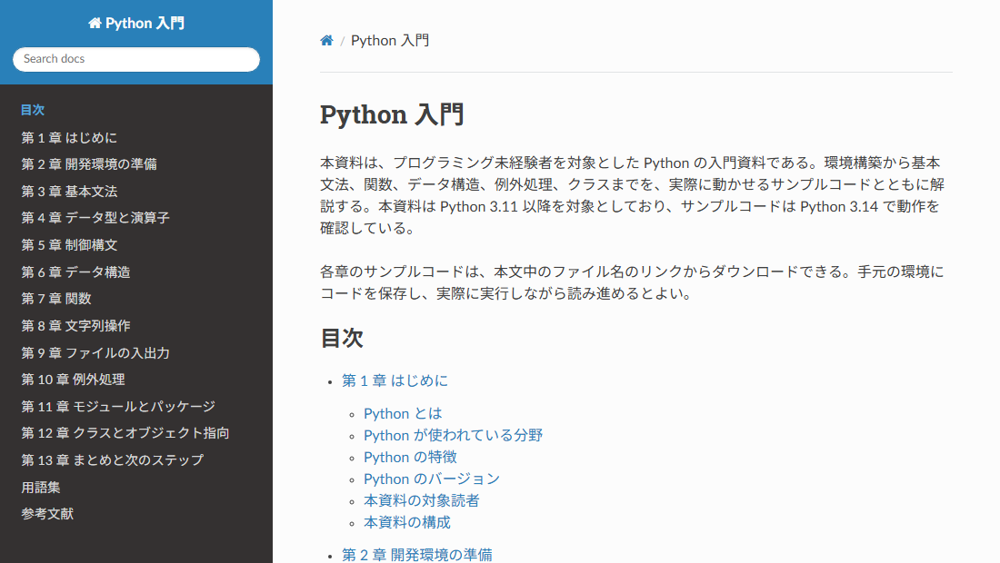

<!-- _class: lead invert -->
<!-- _paginate: false -->

# 仕事で使う Python

**Nunu_3060**
本職はテストエンジニア。
仕事でも趣味でも Python をよく使う。

---

## 目次

1. はじめに
2. データを扱う
3. テストを自動化する
4. 伝える
5. 実務での心得
6. まとめ

---

## なぜ Python か

**仕事の繰り返しのすべてに手が届く**

仕事で繰り返す作業の多くは、次の 3 つに分けられる。

* データ：数値の処理、図の作成、画像の加工
* 手作業：ソフトウェアやサービスの操作
* 文書：結果をまとめて伝える

Python は 1 つの言語で、そのすべてを扱えるライブラリが揃っている。

---

## 今日の全体像

**用途は独立ではなく、つながっている**



---

## 数値計算・データ処理

**大量の解析結果を numpy・pandas で集計する**

* 流体解析の結果は、条件の数だけファイルが増える
* 1 つずつ表計算ソフトで開いて集計するのは辛い

```python
from pathlib import Path
import pandas as pd

paths = Path("results").glob("*.csv")
df = pd.concat(pd.read_csv(p).assign(case=p.stem) for p in paths)
print(df.groupby("case")["velocity"].max())  # ケースごとの最大値
```

---

## 可視化

**同じ体裁の図を何度でも作り直せる**



* 解析結果は図にしないと読めない
* コードで描けば、データが変わっても再実行するだけで済む (図は説明用の例)

---

## 画像処理

**条件違いの図を Pillow で 1 枚に並べる**



* 軸を揃えて並べると、条件による違いを比べやすい
* 図の作成から並べるまでを、スクリプトでつなげられる

---

## テスト実行の自動化

**定型の手順をコードにすると、ミスと手間が減る**

| | 手作業 | スクリプト |
| --- | --- | --- |
| 手順 | 人が覚えておく | コードに書いてある |
| 結果 | 人や日によってぶれる | 毎回同じ |
| 繰り返し | 回数分の手間がかかる | 実行するだけ |
| 記録 | 残しにくい | ログに残せる |

---

## API を叩く

**画面を操作せずに、データの取得や操作ができる**

* REST API を備えたソフトウェア・サービスなら、httpx で叩ける

```python
import httpx

response = httpx.get("https://example.com/api/jobs/42")
response.raise_for_status()  # エラーなら例外にする
job = response.json()
print(job["status"])
```

URL は説明用の例である。

---

## コマンド実行

**Python 以外のソフトウェアも部品にできる**

* コマンドラインから動くソフトウェアなら、subprocess.run で呼べる

```python
import subprocess

subprocess.run(["solver", "--input", "case_01.inp"], check=True)
```

* `check=True` を付けると、失敗したときに例外になる
* solver は説明用の名前である

---

## 組み合わせ：テストの流れ

**部品をつなぐと、テスト全体が 1 回の実行で終わる**



* 実行から合否の判定、図の作成までを人の手を介さずに行う

---

## テスト結果の可視化

**表より図の方が、変化に早く気付ける**



* バージョンごとに並べると、どこで結果が変わったかがすぐ分かる
* 図は説明用の例である

---

## ドキュメント作成

**Sphinx なら文書もテキストとして管理できる**



* 例：Sphinx で作った Python 入門の資料
* コードと同じく、差分を取って変更履歴を残せる

---

## 組み合わせ：図入りの文書

**データの更新が文書まで届く**



* 図を作るスクリプトと文書のソースを一緒に管理する
* データが変わったら、スクリプトと Sphinx を再実行するだけで文書が新しくなる

---

## 実務で気を付けていること

**長く使えるコードにする**

* 小さく始める
  * 最初から完璧な仕組みを作らず、繰り返す手順の一部から自動化する
* 同じ入力から同じ出力を得る
  * 結果を信頼してもらうため、手作業を挟まず再現できるようにする
* 型ヒントを書き、静的解析を通す
  * 時間が経っても、自分や他人が読んで直せるようにする

---

## 自動化すべきか

**「頻度 × 1 回の手間」が書く手間を上回るなら自動化する**



* 何でも自動化すればよいわけではない (図は説明用の例)

---

## まとめ

* Python はデータ・手作業・文書のすべてに手が届く
* 仕事では、流体解析の結果の処理、テストの自動化、文書の作成に使っている
* Python は道具であり、道具をつなぐ接着剤でもある
* まずは身近な繰り返し作業を 1 つ選び、Python にしてみてほしい

---

<!-- _class: refs invert -->

## 参考文献

* NumPy documentation https://numpy.org/doc/stable/
* pandas documentation https://pandas.pydata.org/docs/
* Matplotlib documentation https://matplotlib.org/stable/
* Pillow documentation https://pillow.readthedocs.io/en/stable/
* HTTPX https://www.python-httpx.org/
* subprocess --- サブプロセス管理 https://docs.python.org/ja/3/library/subprocess.html
* Sphinx ドキュメント https://www.sphinx-doc.org/ja/master/
* Nunu_3060「Python 入門」 https://nunu-3060.github.io/sphinx_docs_programming/python_introduction/index.html
* Graphviz https://graphviz.org/
* Marp https://marp.app/
