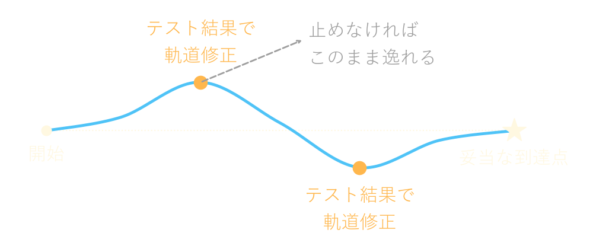

<!-- _class: lead invert -->
<!-- _paginate: false -->

# テストエンジニアの仕事

**Nunu_3060**
本職はテストエンジニア。
流体解析ソフトウェアのテストと、テストを行うシステムの管理・運用をしている。

---

## 目次

1. テストエンジニアとは
2. 私のテストの仕事
3. テストの真の目的
4. まとめ

---

## テストエンジニアとは

**テストを専門に担うエンジニア**

* テストは「欠陥を発見し、品質を評価するための一連の活動」である (JSTQB)
* テストをする役割は、テストの技術的な側面に責任を負う
  * テストの分析・設計・実装・実行
* テストの実行は、テストの仕事の一部に過ぎない

本発表では、この役割を本職とするエンジニアをテストエンジニアと呼ぶ。

---

## テストの目的

**欠陥を見つけることだけが目的ではない**

JSTQB が挙げる典型的なテストの目的 (抜粋)

* 故障を引き起こし、欠陥を発見する
* 仕様化した要件が満たされているかどうかを検証する
* ステークホルダーに根拠ある判断をしてもらうための情報を提供する
* ステークホルダーの期待通りに動作するかどうかの妥当性確認をする

---

## 検証と妥当性確認

**「仕様どおりか」と「目的に合うか」は別の問い**

* 検証：正しく作ったか
* 妥当性確認：正しいものを作ったか

---

## 私がテストしているもの

**流体解析ソフトウェア：結果は数値で出る**

* 流れや熱の伝わり方をコンピューターで計算する
* 計算が最後まで終わり、それらしい数値が出ても、正しいとは限らない
* 流体解析の分野でも、検証と妥当性確認を区別する
  * 検証：方程式を正しく解いているか
  * 妥当性確認：正しい方程式を解いているか

---

## 仕様どおりに動くか

**仕様に照らして確かめる (検証)**

* 機能が仕様どおりに動くか
* 変更によって、既存の機能が壊れていないか (リグレッションテスト)
* 性能は目標を満たしているか

例：高速化したはずのバージョンで計算速度を測った。
しかし、改善は期待したほどではなかった。

---

## 仕様と使用感は妥当か

**仕様どおりでも、使いやすいとは限らない**

* 利用者の立場で、仕様そのものを評価する
* 仕様どおりに動く以上、検証では問題として現れない

例：新機能で今までできなかった解析ができるようになった。
しかし、設定項目が複雑で、使いにくかった。

---

## 解析結果は妥当か

**理論解や実験値と比べて判断する**

例：バージョンを上げたら解析結果が変わった。
どちらが妥当かは、基準と比べて初めて分かる (図は説明用の例)。

---

## 「動く」と「妥当」は別物

**欠陥が無くても、役に立つとは限らない**

> 指定された要件すべてを徹底的にテストし、検出した欠陥すべてを修正しても、ユーザーのニーズや期待を満たさないシステム (中略) が構築されることがある。
> (JSTQB「欠陥ゼロ」の落とし穴)

* 検証と妥当性確認の両方を行って、初めて品質を語れる

---

## テストは手段

**テストをすること自体は目的ではない**

* テストの数を増やしても、製品が良くなるとは限らない
* 欠陥を見つけても、直らなければ製品は良くならない
* 妥当性に疑問があっても、伝わらなければ何も変わらない

では、テストは何のために行うのか。

---

## 真の目的

**物事を妥当な方向に進めること**

間違った方向に進もうとしたら、止めて軌道修正する。

---

## 結果で語る

**意見ではなく、事実を根拠に判断を促す**

* 「使いにくい気がする」ではなく「この設定で、この結果になった」と示す
* 止めるべきだと根拠をもって示し、関係者の判断を促す
* 結果を信頼してもらうため、テストを行うシステムを管理・運用し、同じ条件で繰り返し試せるようにしている

---

## 早く止めるほど安い

**方向の誤りは、早く見つけるほど直しやすい**

* 作り終えてから方向を変えるのは高くつく
* JSTQB の原則の 1 つ：「早期テストで時間とコストを節約」
* だから仕様を決める段階から関わり、仕様そのものもレビューする

---

## そのために必要なもの

**テストの技術だけでは足りない**

* 対象分野の知識：流体力学や数値計算の知識が無ければ、結果の妥当性を判断できない
* 利用者の視点：どう使われるかを想像できなければ、使用感を評価できない
* 伝える力：テストの担当者は悪い知らせの運び手になりやすい。伝え方を誤ると、指摘が受け入れられない

---

## テストエンジニアを頼ってほしい

**最後の関門ではなく、方向を確かめる相手として**

* 仕様を決める段階から声をかけてほしい
* 「これは妥当か」と迷ったら相談してほしい
* 指摘は製品や作った人への批判ではない。同じ目標に向かうための情報である

---

## まとめ

* テストエンジニアは「仕様どおりか (検証)」と「妥当か (妥当性確認)」の両方を確かめる
* テストは手段であり、目的ではない
* 真の目的は、物事を妥当な方向に進め、誤った方向に進もうとしたら止めて軌道修正すること
* テスト内容とテスト結果を根拠に、この目的を果たすのがテストエンジニアの仕事である

---

<!-- _class: refs invert -->

## 参考文献

* JSTQB「テスト技術者資格制度 Foundation Level シラバス 日本語版 Version 2023V4.0.J02」
  https://jstqb.jp/dl/JSTQB-SyllabusFoundation_VersionV40.J02.pdf
* ISTQB "Certified Tester Foundation Level (CTFL) v4.0"
  https://istqb.org/certifications/certified-tester-foundation-level-ctfl-v4-0/
* P. J. Roache, "Verification and Validation in Computational Science and Engineering", Hermosa Publishers, 1998.
* ASME "V&V 20 Standard for Verification and Validation in Computational Fluid Dynamics and Heat Transfer"
  https://www.asme.org/codes-standards/find-codes-standards/standard-for-verification-and-validation-in-computational-fluid-dynamics-and-heat-transfer
